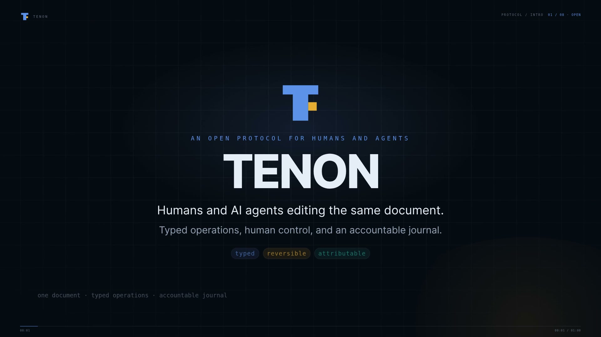

# Tenon

**Typed, reversible, auditable actions for humans and AI agents editing the same document.**

[](https://github.com/Sidharth-Singh10/tenon/actions/workflows/ci.yml)
[](LICENSE)

[](media/tenon-intro-1080p.mp4)

[Watch the 60-second intro](media/tenon-intro-1080p.mp4) — **silent, 1920×1080, 30 fps**. It
explains the gap between seeing and changing, what Tenon is, the typed envelope, the audit log,
human approval for destructive edits, undo as a new turn, and the two adapters.

## What Tenon is

MCP connects agents to tools. Tenon connects them to the document.

Tenon is an open protocol for one shared document edited by a person and an AI agent. Instead of
screenshots or free-text commands, every change is a **typed operation** with an actor, a turn, a
capability, and an idempotency key. A server owns revisions, the append-only journal, and a
hash-chained audit log. The adapter owns the domain objects and their projection.

```text
agent / human
     │  envelope: type · actor · turn · capability · idempotency_key
     ▼
Tenon server ── journal · revisions · audit chain · approvals
     │  dispatch
     ▼
adapter (chart / graph / anything) ── apply · ack · inverse · snapshot
```

Properties that follow from the envelope, not from conventions:

- **Typed** — an operation is validated against a schema before it is applied. A malformed op is
  rejected with a reason, not silently ignored.
- **Attributable** — every entry records who acted: a human, an agent, or a service.
- **Scoped** — a capability names the document and op types it can touch.
- **Reversible** — undo is a new audited turn that replays the original turn’s inverses. Nothing
  is rewritten.
- **Accountable** — acks, inverses, and audit entries are hash-chained, so a missing or altered
  entry is detectable.

The name is the joint: a tenon is the tab that locks two pieces into one load-bearing connection.
Here the pieces are a human and an agent, and the joint is the document.

## Status

Version `0.1.0` is source-ready. The `@tenon-protocol/*` packages build, pack, and install from
tarballs, but **npm publication is intentionally paused**, so the install commands below describe
the published build rather than a live registry entry. The landing page is deployed as a
`noindex` preview until the release. The intro video is complete.

## Repository layout

| Path | Contents |
|---|---|
| `packages/canvas-core/` | Protocol schemas: envelope, ack, capability, audit, turn |
| `packages/canvas-chart/` | Chart adapter: op schemas, `DocStore` reducer, inverses |
| `packages/canvas-graph/` | Graph adapter: nodes, edges, merge, inverses |
| `packages/canvas-conformance/` | Six language-agnostic fixtures and a reference target |
| `packages/canvas-mcp/` | stdio MCP server: `doc_get`, `op_apply`, `turn_undo`, `state_query` |
| `spec/` | Normative protocol v0.1, JSON Schemas, conformance fixtures |
| `server/` | Rust (axum) journal service: revisions, capabilities, approvals, SSE, audit |
| `site/` | Landing page |
| `examples/` | SDK quickstart |
| `docs/` | SDK guide, release guide, v0.1.0 notes |
| `launch/` | Launch essay and post drafts |
| `media/` | 60-second intro video and poster |
| `scripts/` | Distribution smoke test and site build |
| `TENON.md` | Protocol and product build plan |

## Quickstart

Install the protocol and the chart adapter once the packages are published:

```sh
npm install @tenon-protocol/core @tenon-protocol/chart zod
```

```ts
import { DocStore } from "@tenon-protocol/chart"

const store = new DocStore({ checkAnchor: () => ({ ok: true, warnings: [] }) })
store.beginTurn()
store.applyOp({ op: "draw", kind: "hline", points: [{ t: 1_700_000_000, p: 2400 }] })
store.commitTurn()
store.undo()
```

From this checkout, build the packages and run the example instead:

```sh
npm install
npm run build:packages
node examples/chart-quickstart/index.mjs
```

The MCP server exposes a running journal to Claude Desktop, OpenCode, and other MCP clients:

```sh
npx -y @tenon-protocol/mcp
```

Registry name: `io.github.Sidharth-Singh10/tenon`. Server metadata: [`server.json`](server.json).
Configuration: `TENON_URL` (default `http://127.0.0.1:8787`).

## The protocol

An envelope is small, domain-neutral, and forward-compatible:

```json
{
  "v": 1,
  "doc_id": "doc_amaterasu_nifty",
  "turn_id": "turn_ses_9f2:msg_41",
  "seq": 1,
  "actor": { "kind": "agent", "id": "chart-analyst" },
  "capability": "cap_local",
  "type": "chart.shape.create",
  "target": { "kind": "annotation" },
  "payload": { "op": "draw", "kind": "trendline", "points": [] },
  "idempotency_key": "turn_ses_9f2:msg_41:1",
  "created_at": "2026-10-25T10:00:00Z"
}
```

The server replies with an ack: applied or rejected, the assigned revision, the inverse, and — on
rejection — a machine-readable reason and whether a retry can succeed. The full contract, including
capability claims, approval rules, and audit verification, is in
[`spec/protocol.md`](spec/protocol.md).

### Human control

- Destructive operations pause at `approval_required` and need a one-shot human approval bound to
  the document, op type, and capability.
- Undo appends a new turn; the original turn stays in the log.
- A capability can be scoped to a document, a set of op types, and an expiry.

### Conformance

[`spec/conformance/`](spec/conformance/) contains six fixtures that any implementation can run:
anchor survival, undo/redo, idempotent retry, capability denial, malformed op, and audit chain.
They pass against the TypeScript `MemoryTarget` and the Rust journal harness
(`server/tests/conformance.rs`).

## Server

The Rust service is the reference journal. It also carries the Amaterasu reference app’s market
data and agent bridge, so those routes are present alongside the protocol endpoints.

```sh
cargo run --manifest-path server/Cargo.toml
```

| Variable | Purpose |
|---|---|
| `TENON_BIND` | Listen address (default `127.0.0.1:8787`) |
| `TENON_BASE_URL` / `TENON_APP_URL` | Public origin and adapter origin |
| `TENON_DATA_DIR` | Token store and app data |
| `TENON_JOURNAL_DB` | Journal SQLite file |
| `TENON_STATIC_DIR` | Optional built SPA directory to serve |

Protocol endpoints include document metadata and snapshots, op history, audit verification,
capability minting, batch dispatch and acks, human-edit records, approval resolution, and
forward-only turn undo. See [`spec/protocol.md`](spec/protocol.md) for the contract and
[`docs/sdk.md`](docs/sdk.md) for the adapter model.

## Reference implementations

- **Amaterasu** — the chart reference app: live Indian market data, an overlay engine, an embedded
  agent, the journal, and one-shot approvals. [Source](https://github.com/Sidharth-Singh10/Amaterasu)
  · [Live demo](https://sidharth-singh10.github.io/Amaterasu/demo/?demo=1)
- **Weave** — the graph adapter: applies `graph.*` envelopes, merges duplicate nodes, computes
  inverses, and acks the journal. [Source](https://github.com/Sidharth-Singh10/weave)

The chart adapter lives in this repository (`packages/canvas-chart`). Amaterasu currently carries
the same adapter inside its monorepo for its workspace build and will consume the published package
after the release. Weave keeps its graph adapter with its own frontend.

## Landing page and demo

- Landing page (preview): <https://sidharth-singh10.github.io/tenon/>
- Interactive demo (reference app): <https://sidharth-singh10.github.io/Amaterasu/demo/?demo=1>

The demo runs on deterministic sample data with the agent disabled, because it is a static build.
Run Amaterasu locally to connect a model.

## Commands

| Command | Purpose |
|---|---|
| `npm run test:packages` | Protocol package tests (core, chart, graph, MCP, conformance) |
| `npm run typecheck:packages` | Typecheck all five packages |
| `npm run build:packages` | Build ESM + declarations into each package’s `dist/` |
| `npm run verify:dist` | Pack and install all five packages into a clean temp project |
| `npm run schemas` | Regenerate `spec/schemas/` from the zod definitions |
| `npm run verify` | Package typecheck + tests |
| `npm run build:site` | Compose the landing page into `_site/` |
| `cargo test --manifest-path server/Cargo.toml` | Server unit, HTTP, conformance, and latency tests |

## Documentation

- [`spec/protocol.md`](spec/protocol.md) — normative protocol v0.1
- [`spec/conformance/`](spec/conformance/) — fixtures and the conformance runner contract
- [`docs/sdk.md`](docs/sdk.md) — install, adapter model, capabilities, audit, MCP
- [`docs/releasing.md`](docs/releasing.md) — npm, MCP registry, tags, and Pages releases
- [`docs/releases/v0.1.0.md`](docs/releases/v0.1.0.md) — v0.1.0 release notes
- [`docs/extraction-audit.md`](docs/extraction-audit.md) — what moved out of Amaterasu
- [`packages/canvas-mcp/README.md`](packages/canvas-mcp/README.md) — MCP tools and client config
- [`TENON.md`](TENON.md) — protocol and product build plan
- [`launch/essay.md`](launch/essay.md) — why screenshots are the wrong interface
- [`CHANGELOG.md`](CHANGELOG.md) — release history
- [`media/tenon-intro-1080p.mp4`](media/tenon-intro-1080p.mp4) — 60-second intro

## Contributing

Issues and pull requests are welcome. Before opening a PR:

1. Run `npm run verify` and `npm run build:packages && npm run verify:dist`.
2. Run `cargo test --manifest-path server/Cargo.toml`.
3. Use [Conventional Commits](https://www.conventionalcommits.org/) for commit messages.

## License

[MIT](LICENSE)
