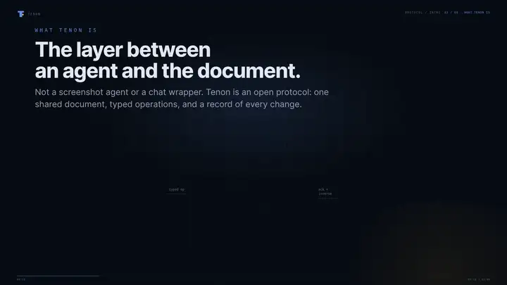

# Tenon

**Typed, reversible, auditable actions for humans and AI agents editing the same document.**

[](https://github.com/Sidharth-Singh10/tenon/actions/workflows/ci.yml)
[](LICENSE)

[](media/tenon-intro-1080p.webm) · [MP4 master](media/tenon-intro-1080p.mp4)

## What Tenon is

MCP connects agents to tools. Tenon connects them to the document.

Tenon is an open protocol for one shared document edited by a person and an AI agent. Every change
is a **typed operation** with an actor, a turn, a capability, and an idempotency key — not a
screenshot or a free-text command. A server owns revisions, the append-only journal, and a
hash-chained audit log; the adapter owns the domain objects and their projection.

```text
agent / human
     │  envelope: type · actor · turn · capability · idempotency_key
     ▼
Tenon server ── journal · revisions · audit chain · approvals
     │  dispatch
     ▼
adapter (chart / graph / anything) ── apply · ack · inverse · snapshot
```

A tenon is the tab that locks two pieces into one connection — here, a human, an agent, and the document.

**Isn't this just MCP?** MCP standardises how an agent reaches a tool; it says nothing about what
happens to the document afterwards. Tenon supplies the revisions, inverses, capability checks, and
audit trail for the result.

**Why not a CRDT?** Conflict-free merge assumes writers never need to explain themselves. Here order
and attribution are the product, so edits are serialised into turns that can be attributed and undone.

## What the envelope buys you

- **Typed** — an op is validated against a schema first; a malformed one is rejected with a reason.
- **Attributable** — every entry records who acted: a human, an agent, or a service.
- **Scoped** — a capability names the document and op types it can touch.
- **Reversible** — undo is a new audited turn replaying the inverses; nothing is rewritten.
- **Accountable** — acks, inverses, and audit entries are hash-chained, so tampering is detectable.

## Quickstart

Everything below runs from a checkout; registry publication is paused (see
[Demo and status](#demo-and-status)).

```sh
git clone https://github.com/Sidharth-Singh10/tenon.git
cd tenon
npm install
npm run build:packages
node examples/chart-quickstart/index.mjs   # three ops, one turn, undo, redo
```

```text
applied: { trend: true, range: true, sma: true }
annotations: 2 series: 1
after undo — annotations: 0 series: 0
after redo — annotations: 2 series: 1
```

`npm run test:conformance` runs the six protocol fixtures the same way.

## Connect an agent

Build, then point an MCP client at the local server:

```json
{
  "mcpServers": {
    "tenon": {
      "command": "node",
      "args": ["/absolute/path/to/tenon/packages/canvas-mcp/dist/main.js"],
      "env": { "TENON_URL": "http://127.0.0.1:8787" }
    }
  }
}
```

The server exposes `doc_get`, `op_apply`, `turn_undo`, and `state_query`. It holds no state:
`TENON_URL` must reach a running journal with a connected adapter. Once published,
`npx -y @tenon-protocol/mcp` replaces the path. Registry: `io.github.Sidharth-Singh10/tenon`.

## How a change flows

1. A capability is minted for a document, a set of op types, and an expiry.
2. The agent sends an envelope: type, target, payload, actor, turn, idempotency key.
3. The server validates it, checks the capability and idempotency key, assigns a revision, journals it.
4. If the op type is destructive, dispatch pauses at `approval_required` until a human approves.
5. The adapter applies the op to its own state and returns an ack carrying the inverse.
6. The server records the ack and audit entry; undo later appends a new turn replaying the inverses.

## The protocol

An envelope is small, domain-neutral, and forward-compatible:

```json
{
  "v": 1,
  "doc_id": "doc_amaterasu_nifty",
  "turn_id": "turn_ses_9f2:msg_41",
  "seq": 1,
  "actor": { "kind": "agent", "id": "chart-analyst" },
  "capability": "cap_local",
  "type": "chart.shape.create",
  "target": { "kind": "annotation" },
  "payload": { "op": "draw", "kind": "trendline", "points": [] },
  "idempotency_key": "turn_ses_9f2:msg_41:1",
  "created_at": "2026-10-25T10:00:00Z"
}
```

The server replies with an ack: applied or rejected, the assigned revision, the inverse, and — on
rejection — a reason and whether a retry can succeed. Chart anchors are data-space `(time, price)`,
never pixels, so a drawing survives pan, zoom, and reload.

### Human control

- Destructive operations need a one-shot approval bound to the document, op type, and capability.
- Undo appends a new turn; the original turn stays in the log.
- A capability can be scoped to a document, a set of op types, and an expiry.

### Conformance

Six fixtures in [`spec/conformance/`](spec/conformance/) cover anchor survival, undo/redo,
idempotent retry, capability denial, malformed op, and the audit chain. They pass against the
TypeScript `MemoryTarget` and the Rust harness (`server/tests/conformance.rs`), so a new
implementation can prove itself rather than assert compatibility. The full contract is in
[`spec/protocol.md`](spec/protocol.md).

## Repository layout

| Path | Contents |
|---|---|
| `packages/canvas-core/` | Protocol schemas: envelope, ack, capability, audit, turn |
| `packages/canvas-chart/` | Chart adapter: op schemas, `DocStore` reducer, inverses |
| `packages/canvas-graph/` | Graph adapter: nodes, edges, merge, inverses |
| `packages/canvas-conformance/` | Six fixtures and a reference target |
| `packages/canvas-mcp/` | stdio MCP server |
| `spec/` | Normative protocol v0.1, JSON Schemas, conformance fixtures |
| `server/` | Rust (axum) journal service: revisions, capabilities, approvals, SSE, audit |
| `site/`, `examples/`, `docs/`, `media/` | Landing page, quickstart, guides, intro video |
| `TENON.md` | Protocol and product build plan |

Directories are named for the adapter (`canvas-chart`); the packages are `@tenon-protocol/chart`.

## Server

```sh
cargo run --manifest-path server/Cargo.toml
```

| Variable | Purpose |
|---|---|
| `TENON_BIND` | Listen address (default `127.0.0.1:8787`) |
| `TENON_BASE_URL` / `TENON_APP_URL` | Public origin and adapter origin |
| `TENON_DATA_DIR` | Token store and app data |
| `TENON_JOURNAL_DB` | Journal SQLite file |
| `TENON_WORKSPACES_DB` | Workspace metadata |
| `TENON_STATIC_DIR` | Optional built SPA directory to serve |

It is the reference journal and also carries Amaterasu’s market data and agent bridge. Routes cover
snapshots, op history, audit verification, capability minting, acks, human edits, approvals, and undo.

## Reference implementations

- **Amaterasu** — the chart reference app: live Indian market data, an overlay engine, an embedded
  agent, the journal, and one-shot approvals. [Source](https://github.com/Sidharth-Singh10/Amaterasu)
  · [Live demo](https://sidharth-singh10.github.io/Amaterasu/demo/?demo=1)
- **Weave** — the graph adapter: applies `graph.*` envelopes, merges duplicate nodes, computes
  inverses, and acks the journal. [Source](https://github.com/Sidharth-Singh10/weave)

The chart adapter lives here; Amaterasu carries a copy until it consumes the published package.

## Demo and status

- [Landing page](https://sidharth-singh10.github.io/tenon/) ·
  [Interactive demo](https://sidharth-singh10.github.io/Amaterasu/demo/?demo=1)

The demo runs on deterministic sample data with the agent disabled, because it is a static build.

Version `0.1.0` is source-ready: the packages build, pack, and install from tarballs, and the server
passes its conformance suite. **npm publication is intentionally paused**, so the install commands in
[`docs/sdk.md`](docs/sdk.md) describe the published build, not a live entry. The landing page stays
`noindex` until the release.

## Commands

| Command | Purpose |
|---|---|
| `npm run verify` | Typecheck and test all five packages |
| `npm run build:packages` | Build ESM + declarations into each package’s `dist/` |
| `npm run verify:dist` | Pack and install all five packages into a clean temp project |
| `npm run schemas` | Regenerate `spec/schemas/` from the zod definitions |
| `cargo test --manifest-path server/Cargo.toml` | Server unit, HTTP, conformance, and latency tests |

## Documentation

- [`spec/protocol.md`](spec/protocol.md) — normative protocol v0.1
- [`docs/sdk.md`](docs/sdk.md) — install, adapter model, capabilities, audit, MCP
- [`docs/releasing.md`](docs/releasing.md) — npm, MCP registry, tags, and Pages releases
- [`packages/canvas-mcp/README.md`](packages/canvas-mcp/README.md) — MCP tools and client config
- [`launch/essay.md`](launch/essay.md) — why screenshots are the wrong interface
- [`CHANGELOG.md`](CHANGELOG.md) — release history

## Contributing

Issues and pull requests are welcome. Before opening a PR:

1. Run `npm run verify` and `npm run build:packages && npm run verify:dist`.
2. Run `cargo test --manifest-path server/Cargo.toml`.
3. Use [Conventional Commits](https://www.conventionalcommits.org/) for commit messages.

## License

[MIT](LICENSE)
